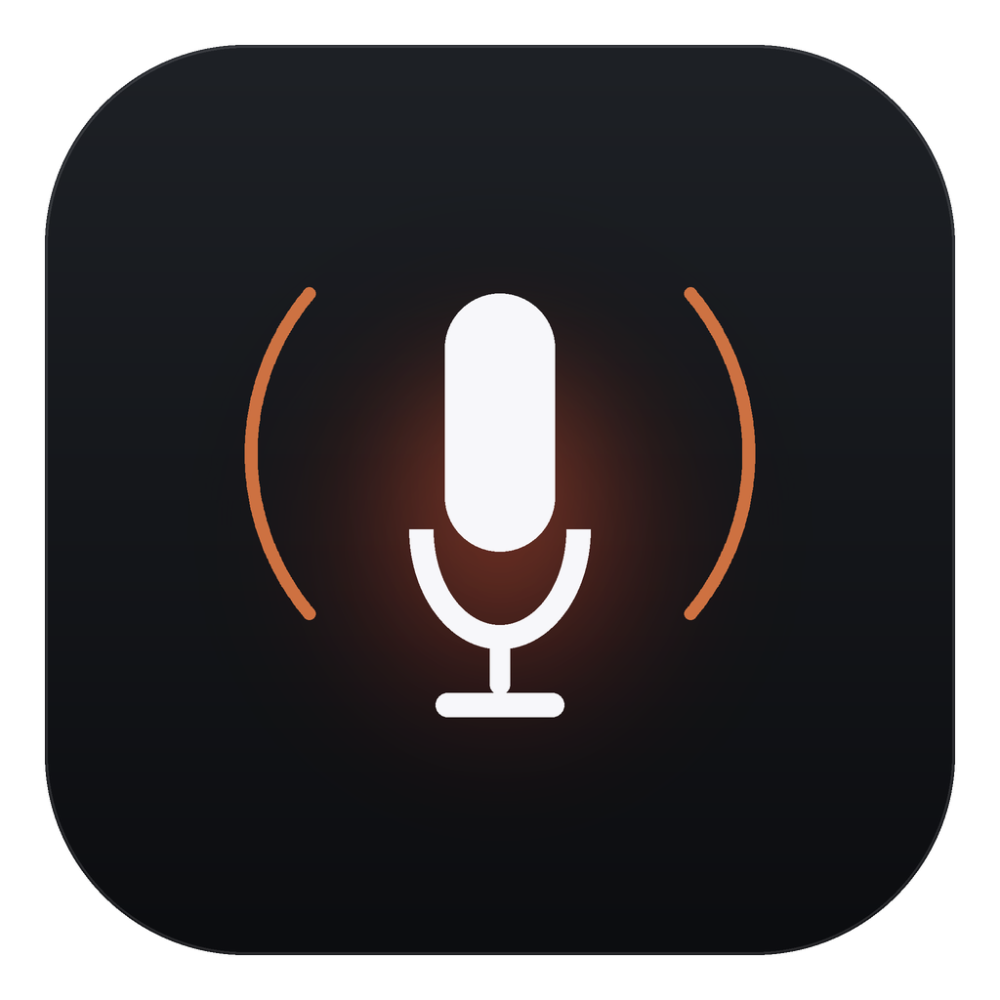
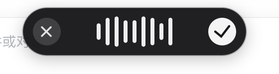
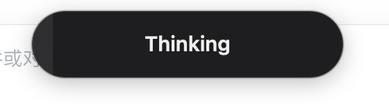
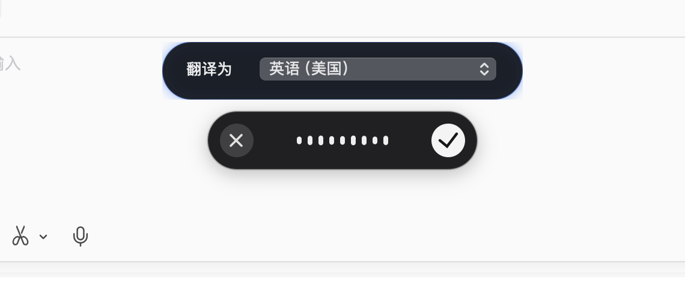
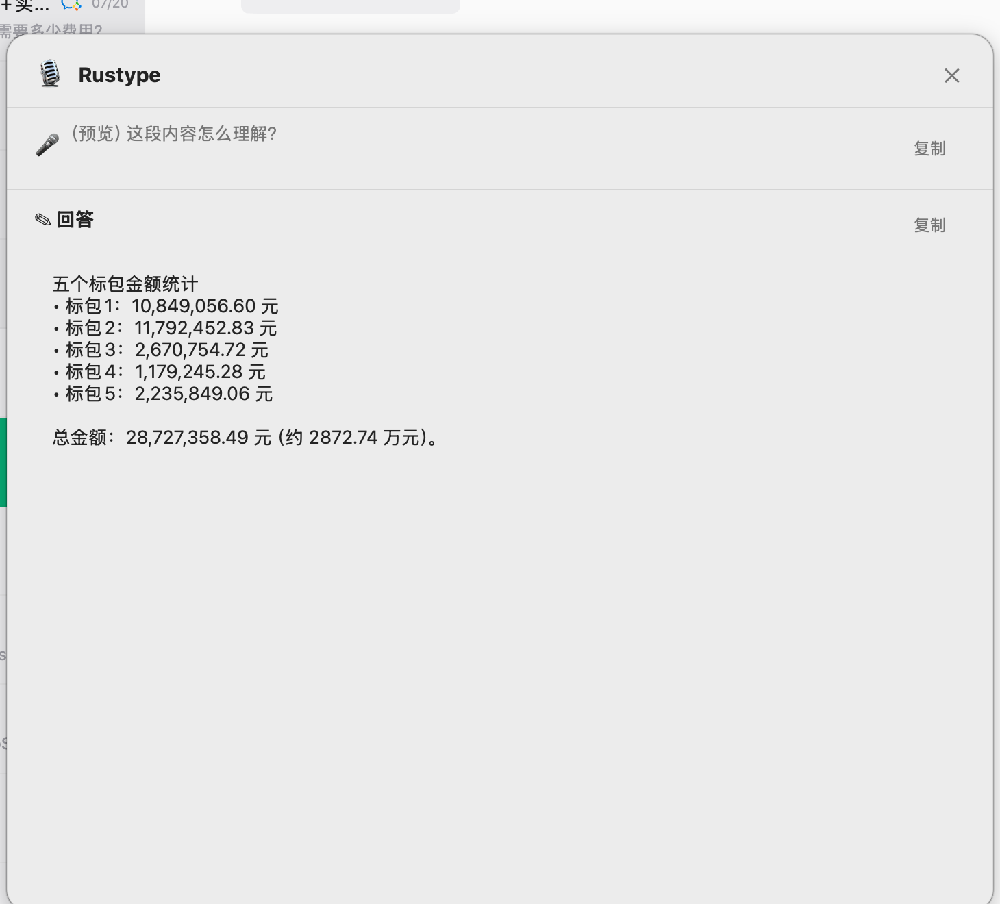
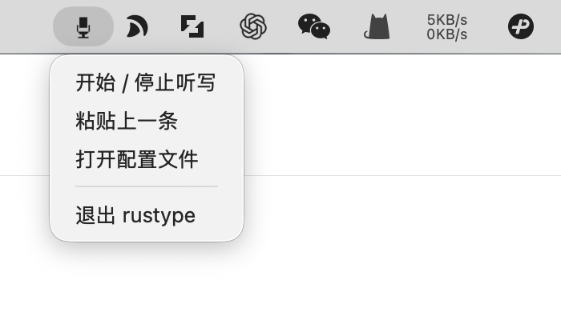
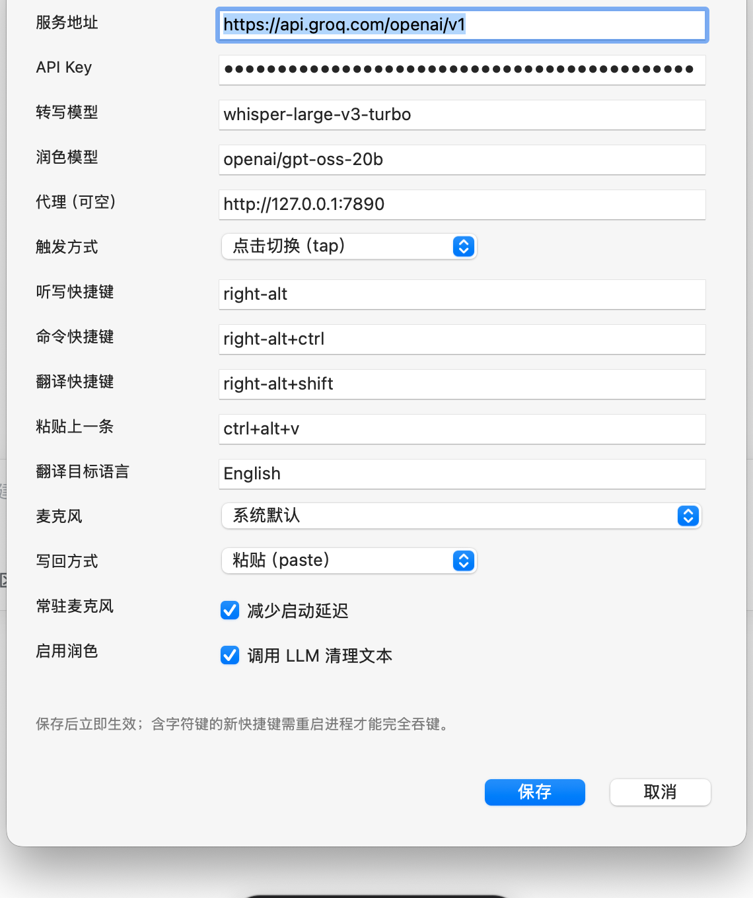

<p align="center"></p>

[English](README.md) | **简体中文**

# rustype

一个用 Rust 复刻的 macOS AI 语音输入工具。点一下右 `Option`（⌥）开始说话，再点一下结束，随后自动转写、润色并写回当前输入框——行为对照 Typeless 2.8.2 逆向分析结果实现。

> 逆向报告见 [docs/REVERSE_ENGINEERING.md](docs/REVERSE_ENGINEERING.md)；
> 完整的思考与取舍过程见 [docs/THINKING_PROCESS.md](docs/THINKING_PROCESS.md)。

## 它做了什么

```
 ┌────────────┐   ● 按住右 Option / 双击免提  ┌──────────────────┐
 │ CGEventTap │ ───────────────────────────▶ │ Session 状态机    │
 │ (⌥/组合键)  │                              │ 录音/模式/取消    │
 └────────────┘                              └───────┬──────────┘
                                                     │ 16 kHz mono
                                             ┌───────▼──────────┐
                                             │ cpal 麦克风采集   │
                                             └───────┬──────────┘
                                     静音裁剪 + 重采样 + WAV
                                             ┌───────▼──────────┐
                                             │ ASR（OpenAI 兼容）│
                                             └───────┬──────────┘
                                  词典 + 应用/窗口/选区上下文
                                             ┌───────▼──────────┐
                                             │ LLM 润色/改写/翻译 │
                                             └───────┬──────────┘
                                       剪贴板 + Cmd+V（或合成键入）
                                             ┌───────▼──────────┐
                                             │ 前台输入框         │
                                             └──────────────────┘
```

## 功能

- **点击切换**（默认）：点一下右 `Option` 开始录音，再点一下结束并进入 Thinking；`Esc` 取消。
- **防幻觉**：静音/音量过低不送 ASR；转写文本长度与录音时长不匹配（如 4 秒静音出现 850 字）会被判为幻觉并丢弃；润色结果异常膨胀时回退到原始转写。
- **按住说话**：在设置面板把「触发方式」改成 hold，即按下开始、松开结束（保留双击免提）。
- **三种模式**：
  - 听写（右 `Option`）：去口水词、自我纠正、自动标点/分段/列表。
  - 提问 / 命令（右 `Option`+`Space`）：有选中文本时按指令改写，没有选中文本时直接回答口述问题。
  - 翻译（右 `Option`+`Shift`）：翻译到配置的目标语言。
- **上下文感知**：注入前台应用名、窗口标题、选中文本、个人词典。
- **写回**：默认「剪贴板 + `Cmd+V`」并恢复原剪贴板；可切换为 Unicode 合成键入。
- **本地历史**：`history.jsonl`，`Ctrl+Cmd+V` 粘贴上一条。
- **可配置**：TOML 配置、任意 OpenAI 兼容端点（OpenAI、Azure 网关、本地 Whisper、Ollama/vLLM 等）。

## 图标与 Logo

<p>
  
  &nbsp;&nbsp;
  
</p>

| 文件 | 用途 |
| --- | --- |
| `assets/icon.svg` / `icon-1024.png` / `icon.icns` | 应用图标（菜单元数据 / Finder） |
| `assets/mark-1024.png` | 独立标记（麦克风 + 声波） |
| `assets/logo.svg` / `logo.png` | 浅色背景横向字标 |
| `assets/logo-dark.png` | 深色背景横向字标 |

设计：深色圆角方形 + 白色麦克风 + 两侧各一道锈橙色电报弧线（电台信号/有信息），整体克制；字标 "Rust" 用墨色、"ype" 用锈橙色。重新生成：

```bash
python3 scripts/make-icons.py   # 需要 Pillow；自动生成 icns
```

## 安装包（DMG）

```bash
scripts/make-dmg.sh          # 重新打包 app + 生成安装镜像
open dist/Rustype-0.1.0.dmg  # 挂载后把 Rustype.app 拖进 Applications
```

- arm64：`scripts/make-dmg.sh` → `dist/Rustype-0.1.0.dmg`
- Universal（arm64 + x86_64）：`scripts/make-universal.sh` → `dist/Rustype-0.1.0-universal.dmg`

镜像内含 `Rustype.app`、`Applications` 快捷方式和一份安装说明。首次打开如被 Gatekeeper 拦截，右键 → 打开；随后在「系统设置 → 隐私与安全性 → 辅助功能」勾选 Rustype。

> 当前为 ad-hoc 签名（未公证），分发给其他 Mac 时需要右键打开，或自行用 Developer ID 签名并公证。

## Intel / Universal 构建

```bash
rustup target add x86_64-apple-darwin --toolchain stable
scripts/make-universal.sh 0.1.0-universal
```

脚本会分别编译 `aarch64-apple-darwin` 与 `x86_64-apple-darwin`，用 `lipo` 合成 Universal 二进制，再打包成 DMG。Intel Mac 直接运行 x86_64 slice；Apple Silicon 运行原生 arm64 slice。

## 快速开始

### 1. 构建

```bash
cargo build --release
# 产物：target/release/rustype
```

### 2. 授权

系统设置 → 隐私与安全性 → **辅助功能**，加入 `rustype` 可执行文件（`Cmd+Shift+G` 可直接输入路径）。
权限用于：全局监听快捷键、向其他 App 合成 `Cmd+V`、读取 AX 选中文本。

> 从终端运行时，macOS 把辅助功能权限记在终端（Terminal/iTerm）名下；用 LaunchAgent 常驻时，需要给 `rustype` 二进制本身授权。`rustype doctor` 会给出提示。

### 3. 配置

```bash
./target/release/rustype config --init    # ~/Library/Application Support/Rustype/config.toml
export RUSTYPE_API_KEY=sk-...             # 或写进 config.toml 的 provider.api_key
./target/release/rustype doctor
```

> 配置默认位于 `~/Library/Application Support/Rustype/`；设置 `RUSTYPE_HOME` 可改成任意目录（本仓库开发时用 `.rustype-home/`）。

### 4. 运行

```bash
scripts/make-app.sh                   # 生成 dist/Rustype.app
./dist/Rustype.app/Contents/MacOS/rustype run   # 推荐：稳定的应用身份，菜单栏图标不会丢
./target/release/rustype run --no-tray          # 无图标（ssh/launchd 纯后台）
```

> macOS 会按“应用身份”记住菜单栏项的位置/隐藏状态。直接运行 `target/release/rustype` 时身份是裸二进制路径，测试中被系统隐藏后重启也不恢复；`.app` 包使用 `com.rustype.desktop`，图标稳定，辅助功能授权也会显示为 Rustype。

启动后菜单栏会出现一个麦克风图标：

- **点击图标**打开菜单：开始/停止听写、粘贴上一条、设置…、打开配置文件、退出；
- **按住右 `Option`** 说话，松开即转写并写回（图标旁显示 `●` 表示录音中，`…` 表示转写中）；
- 三条路径（图标菜单 / 快捷键 / 命令行）共用同一个会话。

| 空闲 | 录音中 |
| --- | --- |
|  |  |

录音时屏幕底部中央会出现悬浮条：左边 ✕ 取消，中间是实时波形，右边 ✓ 结束并转写（点中间区域无操作）：



点 ✓ 之后悬浮条切换为处理态，显示带扫光动画的 **Thinking**，转写和润色完成（或失败）后自动消失：



进入翻译模式（右 `Option` + `Shift`）时，录音胶囊上方会出现语言选择条，支持 16 种常用语言：



- 下拉选择目标语言后立即生效，并写回配置供后续翻译使用；
- 选择条只在翻译模式录音时出现，听写/命令模式不打扰。

### 询问任何问题

命令模式（右 `Option` + `Space`）录音时，胶囊上方会出现提示条：


停止后默认弹出答案卡片，只有“有选区 + 明确改写指令”才替换选区。

### 提问答案卡片

命令模式下默认弹出 Typeless 风格的答案面板，而不是替换选区：



- 顶部：`Rustype` 标题 + 关闭按钮；
- 问题区：麦克风图标 + 你刚才说的话 + 复制按钮；
- 回答区：`回答` 标题 + 复制按钮 + 可滚动、可选择的答案正文；
- 面板颜色跟随系统外观（浅色/深色）；
- 只有**有选区且明确是改写指令**（改写/润色/翻译/缩短…）才会直接替换选区；
- `rustype answer "文本"` 可以单独预览这张卡片。

右键菜单：



### 设置面板

菜单栏图标 →「设置…」打开原生配置面板，改完点保存立即热重载（模型、代理、快捷键、麦克风、写回方式等），不需要重启：



- API Key 使用密码框显示；
- 麦克风、写回方式是下拉选择；
- 保存前会校验快捷键格式，非法配置会弹窗且不落盘；
- 仍保留「打开配置文件」用于编辑提示词等高级项；
- 从托盘菜单打开时保存会立即热重载；用 `rustype settings` 单独打开时只写文件，重启常驻进程后生效。

终端会打印就绪信息；按住右 `Option` 对着麦克风说话，松开即可看到文字出现在当前输入框。

### 5. 开机自启（可选）

```bash
scripts/install-launchagent.sh          # 安装并启动 LaunchAgent
scripts/install-launchagent.sh --remove # 卸载
```

## 快捷键

| 操作 | 默认键 | 说明 |
| --- | --- | --- |
| 听写 | 点右 `Option`（⌥） | 再点一次结束并转写，默认 toggle 模式 |
| 按住说话 | 设置 → 触发方式 → hold | 按下开始、松开结束 |
| 提问 / 改写选中文本 | 右 `Option` + `Space` | 有选中文本则改写，无选中则直接回答 |
| 翻译 | 右 `Option` + `Shift` | 目标语言见 `translation_target` |
| 粘贴上一条 | `Ctrl+Alt+V` | 从本地历史读取 |
| 取消录音 | `Esc` | 丢弃本次录音 |

默认用右 `Option` 是为了不和 Typeless 的 `Fn` 抢占（两者都基于 HID 级监听）。若想沿用 `Fn`，先退出 Typeless，再把 `[hotkeys]` 改回 `fn`。

所有快捷键都可在 `[hotkeys]` 中修改，例如 `fn+space`、`ctrl+alt+d`；属于组合键的字符键会被事件监听器吞掉，不会漏字。

## 配置参考

```toml
[provider]
base_url = "https://api.openai.com/v1"   # 任意 OpenAI 兼容端点
api_key = ""                             # 建议用环境变量 RUSTYPE_API_KEY
asr_model = "whisper-1"                  # 或 gpt-4o-transcribe / 本地模型名
llm_model = "gpt-4o-mini"
language = ""                            # 如 "zh"、"en"；空 = 自动
timeout_secs = 60
proxy = ""                               # 如 "http://127.0.0.1:7890"；空则读 HTTPS_PROXY

[llm]
enabled = true                           # false = 只用 ASR 原文
temperature = 0.2

[audio]
sample_rate = 16000
min_duration_ms = 300                    # 太短的录音直接丢弃
max_duration_ms = 300000                 # 5 分钟自动停止
input_device = ""                        # 名称子串；空 = 系统默认
silence_rms = 0.004                      # 首尾静音裁剪阈值
play_sounds = true
keep_mic_warm = true                     # 常驻音频流，消除设备启动延迟（麦克风指示灯常亮）

[insert]
method = "paste"                         # paste | type
restore_clipboard = true
restore_delay_ms = 250

[hotkeys]
mode = "toggle"                         # toggle（点击切换）或 hold（按住说话）
dictation = "right-alt"
command = "right-alt+space"
translation = "right-alt+shift"
paste_last = "ctrl+alt+v"

dictionary = ["Kubernetes", "Rustype"]   # 个人词典（注入提示词）
translation_target = "English"
history_enabled = true
```

`[prompts]` 中的三个提示词可整体替换，用于定制语气或接入不同模型。

## 命令

| 命令 | 作用 |
| --- | --- |
| `rustype run` | 常驻监听（默认命令） |
| `rustype transcribe <file.wav>` | 离线转写一个 WAV（16-bit PCM / float32）并打印 |
| `rustype devices` | 列出输入设备 |
| `rustype doctor` | 检查权限、配置、API Key、设备 |
| `rustype config [--init]` | 打印/生成配置 |
| `rustype insert "text"` | 测试写回路径 |
| `rustype settings` | 单独打开设置面板（应用未运行时的配置方式） |
| `rustype answer "text"` | 预览答案卡片 |
| `rustype askbar` | 预览“询问任何问题”提示条 |

## 测试

```bash
cargo test            # 核心库单元测试（配置/状态机/音频/提示词/客户端解析）
cargo build           # macOS 完整构建
```

端到端验证（本地 mock provider，不需要真实 API Key）：

```bash
python3 re/mock_provider.py &
RUSTYPE_HOME=$PWD/.rustype-home RUSTYPE_API_KEY=test \
  RUSTYPE_BASE_URL=http://127.0.0.1:8765/v1 \
  cargo run -- transcribe test-tone.wav
```

## 目录结构

```
apps/rustype/             macOS 可执行文件
  src/macos/tap.rs        CGEventTap：Fn、组合键、按键吞噬
  src/macos/audio.rs      cpal 采集
  src/macos/context.rs    NSWorkspace + AX 上下文
  src/macos/insert.rs     剪贴板/Cmd+V/Unicode 键入
  src/session.rs          录音-转写-润色-写回编排
crates/rustype-core/      平台无关核心
  config / hotkey / state / prompt / audio / asr / llm / history
docs/REVERSE_ENGINEERING.md
docs/THINKING_PROCESS.md
re/                       逆向脚本与解包产物（mock provider 也在这里）
```

## 与 Typeless 的差异（有意为之）

- **不复用其云接口**：`/ai/voice_flow` 需要 Typeless 账号 token，且属于第三方服务；这里改成可配置的 OpenAI 兼容端点。
- **不采集整段输入框内容**：Typeless 会上传光标前后文与输入区全文用于润色；rustype 只取前台应用、窗口标题和选中文本，隐私优先。
- **无本地 SQLite / 云同步 / 账号体系**：只保留 JSONL 历史。
- **触发键默认不同**：Typeless 用 `Fn`；rustype 默认用右 `Option`，避免与仍在运行的 Typeless 抢占同一个键。两者都用 HID 级监听，`Fn` 仍可通过配置启用。

## 已知限制

- 仅支持 macOS（Linux/Windows 需要替换 `apps/rustype/src/macos`）。
- 菜单栏图标是基础版：左键长按录音、右键菜单；没有 Typeless 那样的悬浮波形条。
- 默认 `keep_mic_warm = true` 会常驻音频流（麦克风指示灯常亮）以消除启动延迟；介意隐私可设为 `false`，代价是每次开头约 0.4 秒可能被截掉。
- Opus 编码未内置：当前上传 WAV；如接的端点只收 Ogg/Opus，可加 `opus` feature（Typeless 的 32 kbps 参数已记录在逆向报告中）。
- 未实现「Ask anything 的外部动作」（打开链接、创建文档）与个人化统计。

## 合规说明

本项目仅用于学习与互操作研究：不包含 Typeless 的任何代码或资源，不调用其私有接口，不绕过其付费限制。逆向分析针对本机已安装的软件产物，未进行网络抓包或账号数据提取。
